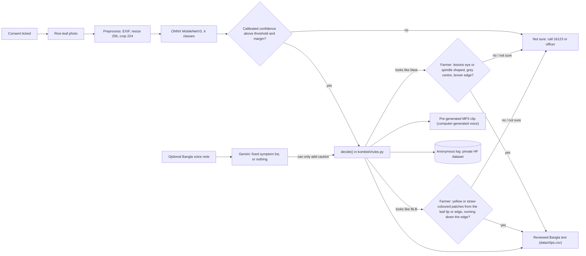

# Kom Bish (কম বিষ) — a Bangla rice adviser that says whether to spray at all

> **DRAFT README (12 Oct 2026).** The app, the rule engine, the tests and a trained classifier exist.
> The Bangla was **reviewed by one native speaker** on 11 and 12 Oct 2026. The audio clips are a **computer-generated voice** that no person has listened to yet. The app is live on a Hugging Face Space. Every `TODO-HUMAN` below marks a fact that does not exist yet.
> No number on this page is invented: each comes from `training/eval_summary.json`.

**Language:** the app, its answers and its audio are in Bangla, for farmers. This README, the model card, the
deck and the video are in English. In the app, tick **Show English (for reviewers)** to see the English
translation under each Bangla answer, headline and prompt; the audio stays Bangla.

Hack for Humanity BD 2026, Round 2 · Team Unsick · Track: Inclusive Rural Development & Agriculture

## What Kom Bish is

**A safe-by-design spray adviser.** It is built to avoid wrong spray advice, not to diagnose everything.

- **It recognises healthy leaves.** True healthy leaves given the "no spray now" answer: 139 of
  152 on our Bangladesh test split, 36 of 37 on our field photos, 112 of 125 on photos from India, and
  27 of 50 on photos from the Philippines. The rest were referred; none got wrong advice.
- **It refers unfamiliar diseases** to the Krishi Call Centre 16123 or an agriculture officer instead of guessing.
- **The two disease answers need the farmer's own "yes".** Before the bacterial leaf blight answer and before
  the blast (spray) answer, the app asks one question about what the farmer sees on the leaf. "No" or "not
  sure" gives a referral.
- **Tested on three countries with 0 wrong spray advice:** Bangladesh (our test split), India (Paddy
  Doctor held-out; **same source as some training data**) and the Philippines (Zambali Rice Dataset (Public V1); truly
  external, never seen in training).
- **Known limit:** on the external test 1 blast leaf was told "no spray now". The healthy answer therefore
  ends by telling the farmer to take a new photo or call 16123 if spots appear or spread.
- **Disease recognition needs local data.** On the external test almost every diseased leaf was referred, not
  recognised. See "Pilot plan" below.

## Try it

- **Live demo:** <https://raiyan465-kom-bish.hf.space> (open this direct link on a phone; the Space page is https://huggingface.co/spaces/Raiyan465/kom-bish)
- **Mirror:** none. For a live pitch the same app runs from a laptop with `python app.py --share`.
- **Demo video:** VIDEO_URL_TODO
- **Pitch deck:** [`deck/Kom_Bish_deck.pptx`](deck/Kom_Bish_deck.pptx) (8 slides, made by `deck/make_deck.py`)
- **All links in one file:** [`submission/links.txt`](submission/links.txt)
- **Test photos:** [`examples/`](examples/), one per rule path, credited in [`examples/CREDITS.md`](examples/CREDITS.md). The BLB and blast examples each show a confirmation question first.

How to try: tick the consent box, upload a rice-leaf photo, press **পরামর্শ নিন**.

## Real vs mocked

| Part | Status |
|---|---|
| Photo classifier | Real: ONNX MobileNetV3-Large, fine-tuned on 12,201 CC BY 4.0 rice photos from Bangladesh and India. **It recognises healthy leaves and refers most diseased ones; diseases from a new source are not recognised** (see Evaluation). Published with its model card at [Raiyan465/kom-bish-rice-leaf](https://huggingface.co/Raiyan465/kom-bish-rice-leaf) (MIT); the previous model is kept there as revision `v1`. |
| Rule engine | Real: pure Python, six rules, [`kombish/rules.py`](kombish/rules.py), tested |
| Voice parsing | Code is real (Gemini `gemini-3.5-flash-lite` returns a fixed symptom list or nothing). Switched **off** until the 10-note accuracy test (gate G3). |
| Spoken answer | **Computer-generated voice.** Seven clips were generated offline with Gemini text-to-speech (`gemini-3.8-flash-tts`; the short "voice failed" clip with `gemini-3.8-flash-lite-tts`) from the exact reviewed on-screen text, and the app labels them "computer-generated voice". Nothing is synthesised live. **No person has listened to them yet**; a machine check could not confirm that the product name is pronounced clearly in the consent clip. A human recording can replace any clip later (`scripts/process_clips.py`). |
| "Estimated sprays avoided" | Advice-based count, unverified: nobody checked what the farmer did next. The team's own smoke tests, live checks and screenshots stay in the log but are tagged and left out of the dashboard counters ([`scripts/tag_test_records.py`](scripts/tag_test_records.py)), so the counters started at 0 on 12 Oct 2026. |
| Telegram, WhatsApp, phone call | Not built |
| Agronomist review | Not yet reviewed by an agronomist |
| Bangla review | Every farmer-facing Bangla line was reviewed by one native speaker (Raiyan Rahman) on 11 Oct 2026, and the BLB question on 12 Oct 2026. The full list is in [`docs/bangla_review.md`](docs/bangla_review.md). |
| Field trial | None |

## The problem

- 73.23% of brinjal farmers followed dealer advice on pesticides ([Mannan et al. 2021](https://banglajol.info/index.php/BJAR/article/view/64710), survey of 2014–15).
- About 21% of pooled vegetable samples were over residue limits ([Toxicology Reports, via DOAJ](https://doaj.org/article/ebb427563ebb4866a52dd8eb382aea54)).
- 92,094 calls reached the Krishi Call Centre 16123 from July 2025 to June 2026 ([BSS](https://www.bssnews.net/special-stories/401845)): farmers do ask for help.

The person who sells the spray is often the person who gives the advice.

## What it does: the four answers

| Answer (Bangla) | In English | When | Source |
|---|---|---|---|
| কীটনাশক লাগবে না, সার ঠিক করুন | No insecticide needed, fix the fertiliser | `R1_BLB`: bacterial leaf blight, confidence at or above the BLB threshold, and the farmer answers "yes" to the BLB question | [BRRI notice, 19 Mar 2023](https://brri.portal.gov.bd/sites/default/files/files/brri.portal.gov.bd/news/245bba32_a089_4da8_9845_d9afcddf455f/2023-04-05-05-24-b9fb45272dcf3a51acb0e89254944725.pdf); [DAE/BAMIS bulletin](https://www.bamis.gov.bd/res/pages/2023/03/19/26691.pdf) |
| স্প্রে লাগবে, তবে ঠিকভাবে | Spray correctly: tricyclazole-group fungicide, label dose, safety script | `R2_BLAST`: blast, very high confidence, and the farmer answers "yes" to the lesion-shape question | BRRI notice; DAE/BAMIS bulletin; [FAO PPE guidelines](https://fao.org/fileadmin/templates/agphome/documents/Pests_Pesticides/Code/Old_guidelines/PROTECT.pdf) |
| এখন কোনো স্প্রে লাগবে না | No spray now, keep watching | `R3_HEALTHY`: healthy leaf | [Ali et al. 2017](https://www.frontiersin.org/journals/environmental-science/articles/10.3389/fenvs.2017.00016/pdf) |
| ছবিটা দেখে আমি নিশ্চিত হতে পারছি না। কৃষি কল সেন্টার: 16123 | Not sure: call 16123 or the Sub-Assistant Agriculture Officer | `R4_OTHER`, `R5_ABSTAIN`, `R6_VOICE_REDFLAG`, `R7_BLAST_UNCONFIRMED`, `R8_BLB_UNCONFIRMED` | [BSS 2026](https://www.bssnews.net/special-stories/401845) |

Every sentence a farmer reads or hears is in [`data/rules.csv`](data/rules.csv) or [`data/clips.csv`](data/clips.csv).

## How it works



1. The photo is classified into one of four classes.
2. Low confidence, or a close second guess, gives a referral instead of an answer.
3. Code picks one of six rules.
4. The farmer sees and hears only pre-written, reviewed text.
5. A voice note, if switched on, can only make the answer more cautious.

## Safety design

- **Closed rule table.** The app cannot say anything that is not in the two CSV files.
- **Code decides; the model only recognises.** No language-model output is shown or spoken as advice.
- **Confidence gate.** One temperature is fitted on validation data; below the threshold or margin the app refers the farmer to 16123 or an officer.
- **Spray advice is stricter than no-spray advice.** "Spray correctly" needs three things: the general
  confidence gate, a blast-only threshold (0.999), and the farmer's own "yes" to one question about the
  lesion shape (eye or spindle shaped, grey centre, brown edge). "No" or "not sure" gives a referral. The
  question was worded by our native-speaker reviewer. Tests: [`tests/test_rules.py`](tests/test_rules.py).
- **The BLB answer is gated the same way** (since 12 Oct 2026). "No insecticide needed, fix the fertiliser"
  needs the general confidence gate, a BLB-only threshold (0.955: the smallest value with no wrong BLB answer on
  the field-background validation photos) and the farmer's own "yes" to one question about where the patches
  start. "No" or "not sure" gives a referral. Each question has its own answer box, so a "yes" to one can
  never confirm the other.
- **Voice can only add caution.** With a voice note the decision is the same as without it, or a referral. Tests enforce this: [`tests/test_rules.py`](tests/test_rules.py).
- **Bacterial leaf blight.** The official notice also lists a sulphur-based foliar mix; Kom Bish deliberately omits it and refers the farmer instead.
- **No brands, no doses.** Kom Bish names active-ingredient groups only as they appear in BRRI/DAE advisories, never brands or doses, and takes no money from input sellers. Dose and harvest wait are "follow the label".
- **Safety script on every spray answer,** based on FAO guidance.
- **Off-script test.** 20 scripted consultations run through the real app path and every sentence is checked against the CSV files: [`tests/test_offscript.py`](tests/test_offscript.py). On 12 Oct 2026 it passed locally: 0 off-script answers and 0 forbidden terms in 20.

## Evaluation

Every number is from [`training/eval_summary.json`](training/eval_summary.json). The full tables with Wilson
95% intervals are in [`training/eval_report.md`](training/eval_report.md); every training run is listed in
[`training/results/runs/README.md`](training/results/runs/README.md).

The same five terms are used everywhere:

- **Classifier confident:** the prediction passes the thresholds and the margin. A confident `other` counts.
- **Advice given:** a confident healthy answer ("no spray now"). It is the only answer the farmer gets from the photo alone.
- **BLB question asked:** a confident BLB prediction. The app then asks where the patches start and gives the BLB answer only on "yes", so with the question unanswered this is **not** counted as advice. A BLB question on a photo that is not BLB would become a wrong "no insecticide needed" if the farmer said yes.
- **Blast question asked:** a confident blast prediction. The app then asks the lesion-shape question and gives the spray answer only on "yes", so with the question unanswered this is **not** counted as advice. A blast question on a photo that is not blast would become a wrong "spray correctly" if the farmer said yes.
- **Referred:** everything else: not confident, or a confident `other`.

Earlier notes quoted two figures for the previous model that looked inconsistent: "coverage 76.0%"
and "212 of 828 answered". The first was *classifier confident*
(629 photos, of which 417 were confident `other`
predictions that become referrals). The second was 183 confident BLB or healthy predictions plus 29 confident blast
predictions. Both were right; they measured different things.

Until 12 Oct 2026 a confident BLB prediction got the BLB answer straight away and was counted under "advice
given". The app now asks the BLB question first, so "advice given" means the healthy answer only and the
older, higher figures in `docs/gates.md` are not comparable. The "if yes" counts below are the worst case:
the farmer answers "yes" to every question.

**The published model (B), thresholds 0.91 general, 0.999 blast, 0.955 BLB, all chosen on validation only.**
The BLB threshold was raised from 0.94 on 12 Oct 2026: it is the smallest value with
0 wrong BLB answers on the field-background validation photos. No weights changed.

- **Our test split, n = 828:** macro-F1 of the top guess 0.883. Classifier confident
  515 (62.2%); advice given 150 (18.1%),
  of which 139 right and 11 wrong; BLB question asked 32 times
  (31 on true BLB, 1 on another disease); blast question asked 0 times.
- **Our field photos, n = 272** (what farmers will send): classifier confident 156
  (57.4%); advice given 36 (13.2%), of which 36 right and
  0 wrong; BLB question asked 32 times (31 on true BLB,
  1 on another disease); blast question asked 0 times. All 18 of 18 true field
  blast photos were referred.
- **Paddy Doctor held-out, n = 500 (same source as some training data):** classifier confident
  327 (65.4%); advice given 113 (22.6%), of which
  112 right and 1 wrong; BLB question asked 103 times
  (103 on true BLB, 0 on another class); blast question asked 6 times, all on true blast.
  These 500 photos were never used for training, validation or thresholds, but they come from the same
  dataset as 8,227 of the training photos, so this is **not** an external test.
- **External test: Zambali Rice Dataset (Public V1) (Philippines), n = 200** (a dataset the model has never
  seen; first scored after the model and thresholds were fixed, and scored again on the same sample after
  the BLB changes of 12 Oct 2026, with the same result):
  classifier confident 69 (34.5%); advice given 28 (14.0%), of
  which 27 right and 1 wrong (a blast leaf told "no spray now"); BLB question asked
  0 times; blast question asked 0 times. The top guess was right for 84 of 200. All 50 of 50 not-a-rice-leaf
  images were referred. **The model recognises healthy leaves from a new source, but not the diseases:** every
  BLB and brown spot photo and all but 1 of the blast photos were referred.
- **The team's own leaves and junk photos:** TODO-HUMAN, not collected yet (step 19).

### Three models through the app's own code path

v1 is the previously published model (still on the Hub as revision `v1`). A is the same recipe with stronger
augmentation only and was rejected. B adds Paddy Doctor training photos and is the published model, shown
with its current BLB threshold. This table was made again on 12 Oct 2026 with the BLB question in the rule
engine; the table B was chosen from is in [`training/results/runs/README.md`](training/results/runs/README.md).

| Model | Set | n | Classifier confident | Advice given | Right advice | Wrong advice | BLB question asked (true BLB / other = wrong BLB answer if "yes") | Blast question asked (true blast / other = wrong spray if "yes") | Referred |
|---|---|---|---|---|---|---|---|---|---|
| v1 (previous) | our test split | 828 | 629 (76.0%) | 146 (17.6%) | 142 | 4 | 37 (35 / 2) | 29 (28 / 1) | 616 |
| v1 (previous) | our field photos | 272 | 208 (76.5%) | 35 (12.9%) | 35 | 0 | 37 (35 / 2) | 0 (0 / 0) | 200 |
| v1 (previous) | Paddy Doctor held-out | 500 | 194 (38.8%) | 7 (1.4%) | 7 | 0 | 13 (0 / 13) | 0 (0 / 0) | 480 |
| A (not published) | our test split | 828 | 503 (60.7%) | 131 (15.8%) | 127 | 4 | 37 (34 / 3) | 51 (51 / 0) | 609 |
| A (not published) | our field photos | 272 | 152 (55.9%) | 33 (12.1%) | 33 | 0 | 38 (34 / 4) | 0 (0 / 0) | 201 |
| A (not published) | Paddy Doctor held-out | 500 | 84 (16.8%) | 0 (0.0%) | 0 | 0 | 3 (0 / 3) | 0 (0 / 0) | 497 |
| B (published) | our test split | 828 | 515 (62.2%) | 150 (18.1%) | 139 | 11 | 32 (31 / 1) | 0 (0 / 0) | 646 |
| B (published) | our field photos | 272 | 156 (57.4%) | 36 (13.2%) | 36 | 0 | 32 (31 / 1) | 0 (0 / 0) | 204 |
| B (published) | Paddy Doctor held-out (**same source as some training data**) | 500 | 327 (65.4%) | 113 (22.6%) | 112 | 1 | 103 (103 / 0) | 6 (6 / 0) | 278 |

CPU latency, median of 30 predictions on a 1024×768 image: v1 (previous) 10.3 ms; A (not published) 14.0 ms; B (published) 13.7 ms (the same architecture; the differences are run-to-run noise).

### How we got here

Our first model scored 0.921 macro-F1 on its own test split and then recognised 2 of 74 field blast photos
from a third dataset: blast leaves in our data lie on a white sheet and BLB leaves are photographed in the
field, so it had learned the background. We added that third dataset (Dhan-Shomadhan) to training, which
removed our first external test, and made spray advice stricter than no-spray advice (a blast-only
threshold, and a lesion-shape question the farmer must answer "yes" to). A first external test on Paddy
Doctor (India) then showed the model did not transfer at all, so we added Paddy Doctor training photos,
keeping 500 held out. The external test above, on a Philippine dataset, is the only number here from a
source the published model has never seen. On 11 Oct 2026 we tried four close-up web photos of blast: none
was recognised and one got the BLB answer. We kept the model and made the BLB answer as cautious as the
blast answer: a higher BLB threshold and a question the farmer must answer "yes" to.

## Privacy

- **Logged, per consultation:** `id`, `type`, `ts_utc`, `app_version`, `predicted_class`, `confidence`, `probs`, `abstained`, `voice_used`, `voice_symptoms`, `voice_confidence`, `growth_stage`, `planning_to_spray`, `rule_id`, `decision`, `latency_ms`, `consent_version`, `feedback`.
- **Never stored:** the photo, the audio, the transcript, IP addresses, names, phone numbers. The logger refuses any other field ([`kombish/logging_store.py`](kombish/logging_store.py)).
- Logs go to a private Hugging Face dataset.
- Voice notes, when switched on, are processed by Google's Gemini free tier, whose content "is used to improve our products". The consent text says so.
- Consent is shown before any input. The Personal Data Protection Ordinance 2025 requires explicit consent; its later legal status is uncertain, so we comply anyway.

## Run locally

```bash
python3.12 -m venv .venv && source .venv/bin/activate     # Windows: py -3.12 -m venv .venv ; .venv\Scripts\activate
pip install -r requirements-render.txt -r requirements-dev.txt
cp .env.example .env          # set MODEL_REPO; LOG_REPO/HF_TOKEN/GEMINI_API_KEY optional
python app.py                 # http://localhost:7860
pytest -q                     # safety invariants and app paths
```

## Judging-criteria map

Round 2 is judged technically; the finale is judged on social and human impact, feasibility and scalability.

- **Running code:** [live demo](https://raiyan465-kom-bish.hf.space), [tests](tests/), [CI](.github/workflows/tests.yml).
- **Technical depth:** temperature scaling and an abstain threshold, single-file ONNX with a parity check, [`training/`](training/).
- **Impact:** spray-or-not answers. Evidence that fewer sprays are possible is from other studies; a pilot will measure what Kom Bish delivers.
- **Feasibility:** a USD 0 stack that runs on free hosts and on a laptop.
- **Scalability:** all configuration comes from environment variables; the rules live in a CSV. Next: review by a Sub-Assistant Agriculture Officer and a 30-farmer pilot.

## Pilot plan (a plan, not a built feature)

Nothing in this section exists yet. Today the app stores no photos.

The model recognises diseases only on sources it has trained on, so the way to make it useful in a new place
is local data with trustworthy labels. The referral already sends the farmer to the person who can provide
that label:

1. **Review first.** A Sub-Assistant Agriculture Officer (SAAO) reads the rule table and the answer scripts.
2. **A small pilot,** about 30 farmers in one block, photo-only.
3. **Officer-verified referrals become training data.** When Kom Bish refers a farmer and the officer then
   sees the crop, the officer records what it was. With a separate, explicit consent, that photo and the
   officer's label are kept. This needs a new consent text and a new, reviewed way to store photos; neither
   is built, and the current "we do not keep your photo" promise stays true until they are.
4. **Retrain only with a held-out local test.** Part of the officer-labelled photos is set aside and never
   trained on. A new model replaces the old one only if it gives more right answers on that set, no more
   wrong spray advice, and no loss on the existing tests: the same rule used for model v2.
5. **What the pilot measures:** how often the app refers, how often the officer agrees with its answers, any
   wrong advice, and whether the farmer sprayed.

## Data credits and licences

- RiceLeafBD, DOI 10.17632/kx9rx8p2mz.1, CC BY 4.0 (please also cite arXiv 2501.08912)
- RiceLeafDisease-BD5, DOI 10.17632/sjkptpgv79.2, CC BY 4.0
- Dhan-Shomadhan, DOI 10.17632/znsxdctwtt.1, CC BY 4.0, via the Hugging Face mirror `Project-AgML/Dhan-Shomadhan_rice_leaf_disease_classification` (used for training; 18 field blast photos held out)
- Paddy Doctor, CC BY 4.0 (Kaggle competition rules, section 7.A): Petchiammal A, Briskline Kiruba S, D. Murugan, Pandarasamy A (2022), "Paddy Doctor: A Visual Image Dataset for Automated Paddy Disease Classification and Benchmarking", arXiv:2205.11108; project page https://paddydoc.github.io/ ; data https://www.kaggle.com/competitions/paddy-disease-classification (used for training; 500 photos held out)
- External test only, never trained on: Zambali Rice Dataset (Public V1), https://www.kaggle.com/datasets/gettingintoml/zambali-rice-dataset-v3-1 (Apache-2.0 (as stated on the Kaggle dataset page))
- Base weights: `timm/mobilenetv3_large_100.ra_in1k` (Apache-2.0)
- Advice sources: BRRI, DAE/BAMIS, FAO, Ali et al. 2017
- Model repository: [Raiyan465/kom-bish-rice-leaf](https://huggingface.co/Raiyan465/kom-bish-rice-leaf) (MIT)

## Limitations

- **Diseases are not recognised on a new source.** On the external test the model recognised healthy leaves
  and referred almost every diseased one. No truly external test shows it recognising BLB or blast.
- **Close-up web photos of blast were not recognised.** We tried four textbook-style blast photos from the
  web (not a test set, labels not checked by an agronomist): none was called blast, three were referred and
  one got the BLB answer ("no insecticide needed, fix the fertiliser"), which is wrong advice. After the
  BLB threshold was raised (on validation data, not on these photos) and the BLB question was added, all
  four are referred; none is recognised as blast. See [`docs/gates.md`](docs/gates.md).
- **The Paddy Doctor held-out result is the same source as some training data.** It is not an external test.
- **Blast is rarely answered.** The blast threshold is 0.999: the blast question was asked 0 times
  on our test split and 6 times on the 500 Paddy Doctor held-out photos (125 of them blast).
- **Narrow brown spot leaves on a white sheet are told "no spray now":** every wrong answer on our test
  split is a BD5 narrow brown spot photo answered `healthy`. None are field photos.
- **The BLB question is sometimes asked on a leaf that is not BLB:** once on our test split (a tungro
  photo). If the farmer answered "yes" there, the BLB answer would be wrong.
- The model expects a close-up of one leaf, or a field shot like Paddy Doctor's. Other framings are untested.
- Source and background confound: all BLB images in our own data come from one dataset (field photos) and
  most blast images from another (leaves on a white sheet).
- BD5's official archive (version 2, SHA-256 verified) holds 3,150 images; its own description says 2,545.
  We used what the archive contains.
- We looked at our test split while comparing training runs, so its numbers are somewhat optimistic.
- The two confirmation questions (BLB and blast) rely on the farmer's own judgement and have not been
  tested with farmers.
- No field test. Nobody has checked what a farmer did after an answer.
- The rules are not yet signed off by an agronomist.
- The Bangla was reviewed by one native speaker, not two, and not by an agronomist.
- TODO-HUMAN: voice accuracy, from a 10-note test only (gate G3).
- The `other` class does not cover non-rice photos.

## Team

TODO-HUMAN: team member names, if the team wants them listed.

## Licence

MIT for the code ([`LICENSE`](LICENSE)). The data keeps its own licences. Dataset images are not committed,
except credited examples.
