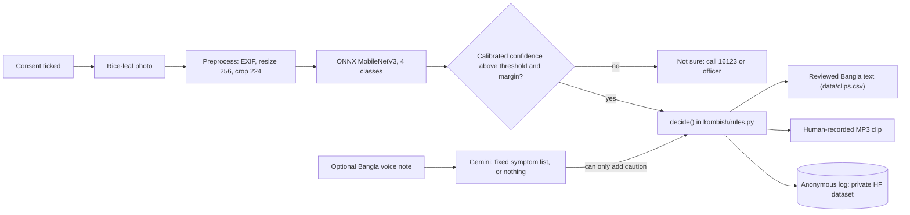

# Kom Bish (কম বিষ) — a Bangla rice adviser that says whether to spray at all

> **DRAFT README (11 Oct 2026).** The app, the rule engine and the tests are built and passing. The
> classifier is **not trained yet**, the Bangla is **not yet reviewed** by native speakers, the audio
> clips are **not recorded** and nothing is hosted. Every `TODO-HUMAN` below marks a fact that does not
> exist yet. No number on this page is invented: the evaluation section stays empty until the real run.

TODO-HUMAN (C): one-line pitch in Bangla. DRAFT — needs native speaker review.

Hack for Humanity BD 2026, Round 2 · Team Unsick · Track: Inclusive Rural Development & Agriculture

## Try it

- **Live demo:** TODO-HUMAN (direct HTTPS URL; first load can take about a minute if it is the Render host)
- **Mirror:** TODO-HUMAN
- **Demo video:** VIDEO_URL_TODO
- **Pitch deck:** `deck/Kom_Bish_deck.pptx` (TODO-HUMAN: not generated yet, step 22)
- **Test photos:** [`examples/`](examples/) (TODO-HUMAN: not chosen yet, step 19)

How to try: tick the consent box, upload a rice-leaf photo, press **পরামর্শ নিন**.

## Real vs mocked

| Part | Status |
|---|---|
| Photo classifier | TODO-HUMAN: not trained yet. Planned: ONNX MobileNetV3-Large, fine-tuned on CC BY 4.0 Bangladeshi rice-leaf images (step 10). The app refuses to start without a real model; there is no dummy model. |
| Rule engine | Real: pure Python, six rules, [`kombish/rules.py`](kombish/rules.py), tested |
| Voice parsing | Code is real (Gemini returns a fixed symptom list or nothing). Switched **off** until the 10-note accuracy test (gate G3). |
| Spoken answer | TODO-HUMAN: pre-recorded human clips, not recorded yet (step 16). No live text-to-speech. |
| "Estimated sprays avoided" | Advice-based count, unverified: nobody checked what the farmer did next |
| Telegram, WhatsApp, phone call | Not built |
| Agronomist review | Not yet reviewed by an agronomist |
| Bangla review | TODO-HUMAN: all Bangla text is still a draft (step 06) |
| Field trial | None |

## The problem

- 73.23% of brinjal farmers followed dealer advice on pesticides ([Mannan et al. 2021](https://banglajol.info/index.php/BJAR/article/view/64710), survey of 2014–15).
- About 21% of pooled vegetable samples were over residue limits ([Toxicology Reports, via DOAJ](https://doaj.org/article/ebb427563ebb4866a52dd8eb382aea54)).
- 92,094 calls reached the Krishi Call Centre 16123 from July 2025 to June 2026 ([BSS](https://www.bssnews.net/special-stories/401845)): farmers do ask for help.

The person who sells the spray is often the person who gives the advice.

## What it does: the four answers

| Answer (Bangla, DRAFT) | In English | When | Source |
|---|---|---|---|
| কীটনাশক লাগবে না, সার ঠিক করুন | No insecticide needed, fix the fertiliser | `R1_BLB`: bacterial leaf blight | [BRRI notice, 19 Mar 2023](https://brri.portal.gov.bd/sites/default/files/files/brri.portal.gov.bd/news/245bba32_a089_4da8_9845_d9afcddf455f/2023-04-05-05-24-b9fb45272dcf3a51acb0e89254944725.pdf); [DAE/BAMIS bulletin](https://www.bamis.gov.bd/res/pages/2023/03/19/26691.pdf) |
| স্প্রে লাগবে, তবে ঠিকভাবে | Spray correctly: tricyclazole-group fungicide, label dose, safety script | `R2_BLAST`: blast | BRRI notice; DAE/BAMIS bulletin; [FAO PPE guidelines](https://fao.org/fileadmin/templates/agphome/documents/Pests_Pesticides/Code/Old_guidelines/PROTECT.pdf) |
| এখন কোনো স্প্রে লাগবে না | No spray now, keep watching | `R3_HEALTHY`: healthy leaf | [Ali et al. 2017](https://www.frontiersin.org/journals/environmental-science/articles/10.3389/fenvs.2017.00016/pdf) |
| ছবিটা দেখে আমি নিশ্চিত হতে পারছি না। কৃষি কল সেন্টার: 16123 | Not sure: call 16123 or the Sub-Assistant Agriculture Officer | `R4_OTHER`, `R5_ABSTAIN`, `R6_VOICE_REDFLAG` | [BSS 2026](https://www.bssnews.net/special-stories/401845) |

Every sentence a farmer reads or hears is in [`data/rules.csv`](data/rules.csv) or [`data/clips.csv`](data/clips.csv).

## How it works



1. The photo is classified into one of four classes.
2. Low confidence, or a close second guess, gives a referral instead of an answer.
3. Code picks one of six rules.
4. The farmer sees and hears only pre-written, reviewed text.
5. A voice note, if switched on, can only make the answer more cautious.

## Safety design

- **Closed rule table.** The app cannot say anything that is not in the two CSV files.
- **Code decides; the model only recognises.** No language-model output is shown or spoken as advice.
- **Confidence gate.** One temperature is fitted on validation data; below the threshold or margin the app refers the farmer to 16123 or an officer.
- **Voice can only add caution.** With a voice note the decision is the same as without it, or a referral. Tests enforce this: [`tests/test_rules.py`](tests/test_rules.py).
- **Bacterial leaf blight.** The official notice also lists a sulphur-based foliar mix; Kom Bish deliberately omits it and refers the farmer instead.
- **No brands, no doses.** Kom Bish names active-ingredient groups only as they appear in BRRI/DAE advisories, never brands or doses, and takes no money from input sellers. Dose and harvest wait are "follow the label".
- **Safety script on every spray answer,** based on FAO guidance.
- **Off-script test.** 20 scripted consultations run through the real app path and every sentence is checked against the CSV files: [`tests/test_offscript.py`](tests/test_offscript.py). On 11 Oct 2026 it passed locally: 0 off-script answers and 0 forbidden terms in 20.

## Evaluation

TODO-HUMAN: no real numbers yet. The classifier has not been trained (step 10) and the team's own photos
have not been collected (step 19). `training/make_eval_report.py` writes `training/eval_report.md` and
`training/eval_summary.json`, and this section is then filled from those files only, each number with its n:

- test n and macro-F1 with no abstention
- threshold, margin, coverage and selective accuracy
- precision on BLB answers and on blast answers
- Dhan-Shomadhan field blast (a dataset never used for training): n, recall, abstain rate
- the team's own healthy-looking leaves wrongly answered as BLB or blast (k of n)
- junk photos refused (k of n)

Known in advance: every BLB image comes from one dataset and every training blast image from another, so
the model may learn the source rather than the disease. Recall per source and the cross-source blast test
are reported for that reason.

## Privacy

- **Logged, per consultation:** `id`, `type`, `ts_utc`, `app_version`, `predicted_class`, `confidence`, `probs`, `abstained`, `voice_used`, `voice_symptoms`, `voice_confidence`, `growth_stage`, `planning_to_spray`, `rule_id`, `decision`, `latency_ms`, `consent_version`, `feedback`.
- **Never stored:** the photo, the audio, the transcript, IP addresses, names, phone numbers. The logger refuses any other field ([`kombish/logging_store.py`](kombish/logging_store.py)).
- Logs go to a private Hugging Face dataset.
- Voice notes, when switched on, are processed by Google's Gemini free tier, whose content "is used to improve our products". The consent text says so.
- Consent is shown before any input. The Personal Data Protection Ordinance 2025 requires explicit consent; its later legal status is uncertain, so we comply anyway.

## Run locally

```bash
python3.12 -m venv .venv && source .venv/bin/activate     # Windows: py -3.12 -m venv .venv ; .venv\Scripts\activate
pip install -r requirements-render.txt -r requirements-dev.txt
cp .env.example .env          # set MODEL_REPO; LOG_REPO/HF_TOKEN/GEMINI_API_KEY optional
python app.py                 # http://localhost:7860
pytest -q                     # safety invariants and app paths
```

## Judging-criteria map

Round 2 is judged technically; the finale is judged on social and human impact, feasibility and scalability.

- **Running code:** live demo (TODO-HUMAN), [tests](tests/), [CI](.github/workflows/tests.yml).
- **Technical depth:** temperature scaling and an abstain threshold, single-file ONNX with a parity check, [`training/`](training/).
- **Impact:** spray-or-not answers. Evidence that fewer sprays are possible is from other studies; a pilot will measure what Kom Bish delivers.
- **Feasibility:** a USD 0 stack that runs on free hosts and on a laptop.
- **Scalability:** all configuration comes from environment variables; the rules live in a CSV. Next: review by a Sub-Assistant Agriculture Officer and a 30-farmer pilot.

## Data credits and licences

- RiceLeafBD, DOI 10.17632/kx9rx8p2mz.1, CC BY 4.0 (please also cite arXiv 2501.08912)
- RiceLeafDisease-BD5, DOI 10.17632/sjkptpgv79.2, CC BY 4.0
- Dhan-Shomadhan, DOI 10.17632/znsxdctwtt.1, CC BY 4.0, via the Hugging Face mirror `Project-AgML/Dhan-Shomadhan_rice_leaf_disease_classification`
- Base weights: `timm/mobilenetv3_large_100.ra_in1k` (Apache-2.0)
- Advice sources: BRRI, DAE/BAMIS, FAO, Ali et al. 2017
- Model repository: TODO-HUMAN (step 11)

## Limitations

- Single-source confound: all BLB training images come from one dataset and all blast images from another.
- No field test. Nobody has checked what a farmer did after an answer.
- The rules are not yet signed off by an agronomist.
- TODO-HUMAN: who reviewed the Bangla (step 06).
- TODO-HUMAN: voice accuracy, from a 10-note test only (gate G3).
- The `other` class does not cover non-rice photos.

## Team

TODO-HUMAN: team member names, if the team wants them listed.

## Licence

MIT for the code ([`LICENSE`](LICENSE)). The data keeps its own licences. Dataset images are not committed,
except credited examples.
