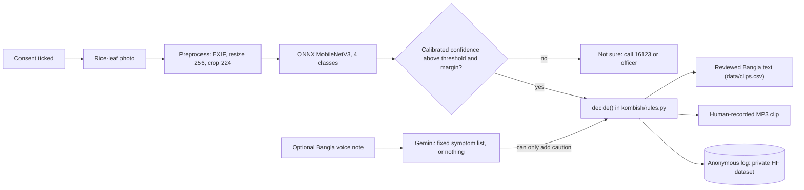

# Kom Bish (কম বিষ) — a Bangla rice adviser that says whether to spray at all

> **DRAFT README (11 Oct 2026).** The app, the rule engine, the tests and a trained classifier exist.
> The Bangla is **not yet reviewed** by native speakers, the audio clips are **not recorded** and nothing
> is hosted. Every `TODO-HUMAN` below marks a fact that does not exist yet.
> No number on this page is invented: each comes from `training/eval_summary.json`.

TODO-HUMAN (C): one-line pitch in Bangla. DRAFT — needs native speaker review.

Hack for Humanity BD 2026, Round 2 · Team Unsick · Track: Inclusive Rural Development & Agriculture

## Try it

- **Live demo:** TODO-HUMAN (direct HTTPS URL; first load can take about a minute if it is the Render host)
- **Mirror:** TODO-HUMAN
- **Demo video:** VIDEO_URL_TODO
- **Pitch deck:** `deck/Kom_Bish_deck.pptx` (TODO-HUMAN: not generated yet, step 22)
- **Test photos:** [`examples/`](examples/) (TODO-HUMAN: not chosen yet, step 19)

How to try: tick the consent box, upload a rice-leaf photo, press **পরামর্শ নিন**.

## Real vs mocked

| Part | Status |
|---|---|
| Photo classifier | Real: ONNX MobileNetV3-Large, fine-tuned on 3,974 CC BY 4.0 Bangladeshi rice-leaf images. **Weak on blast in field photos: it mostly refers instead of answering** (see Evaluation). Published with its model card at [Raiyan465/kom-bish-rice-leaf](https://huggingface.co/Raiyan465/kom-bish-rice-leaf) (MIT). |
| Rule engine | Real: pure Python, six rules, [`kombish/rules.py`](kombish/rules.py), tested |
| Voice parsing | Code is real (Gemini `gemini-3.5-flash-lite` returns a fixed symptom list or nothing). Switched **off** until the 10-note accuracy test (gate G3). |
| Spoken answer | TODO-HUMAN: pre-recorded human clips, not recorded yet (step 16). No live text-to-speech. |
| "Estimated sprays avoided" | Advice-based count, unverified: nobody checked what the farmer did next |
| Telegram, WhatsApp, phone call | Not built |
| Agronomist review | Not yet reviewed by an agronomist |
| Bangla review | TODO-HUMAN: all Bangla text is still a draft (step 06) |
| Field trial | None |

## The problem

- 73.23% of brinjal farmers followed dealer advice on pesticides ([Mannan et al. 2021](https://banglajol.info/index.php/BJAR/article/view/64710), survey of 2014–15).
- About 21% of pooled vegetable samples were over residue limits ([Toxicology Reports, via DOAJ](https://doaj.org/article/ebb427563ebb4866a52dd8eb382aea54)).
- 92,094 calls reached the Krishi Call Centre 16123 from July 2025 to June 2026 ([BSS](https://www.bssnews.net/special-stories/401845)): farmers do ask for help.

The person who sells the spray is often the person who gives the advice.

## What it does: the four answers

| Answer (Bangla, DRAFT) | In English | When | Source |
|---|---|---|---|
| কীটনাশক লাগবে না, সার ঠিক করুন | No insecticide needed, fix the fertiliser | `R1_BLB`: bacterial leaf blight | [BRRI notice, 19 Mar 2023](https://brri.portal.gov.bd/sites/default/files/files/brri.portal.gov.bd/news/245bba32_a089_4da8_9845_d9afcddf455f/2023-04-05-05-24-b9fb45272dcf3a51acb0e89254944725.pdf); [DAE/BAMIS bulletin](https://www.bamis.gov.bd/res/pages/2023/03/19/26691.pdf) |
| স্প্রে লাগবে, তবে ঠিকভাবে | Spray correctly: tricyclazole-group fungicide, label dose, safety script | `R2_BLAST`: blast | BRRI notice; DAE/BAMIS bulletin; [FAO PPE guidelines](https://fao.org/fileadmin/templates/agphome/documents/Pests_Pesticides/Code/Old_guidelines/PROTECT.pdf) |
| এখন কোনো স্প্রে লাগবে না | No spray now, keep watching | `R3_HEALTHY`: healthy leaf | [Ali et al. 2017](https://www.frontiersin.org/journals/environmental-science/articles/10.3389/fenvs.2017.00016/pdf) |
| ছবিটা দেখে আমি নিশ্চিত হতে পারছি না। কৃষি কল সেন্টার: 16123 | Not sure: call 16123 or the Sub-Assistant Agriculture Officer | `R4_OTHER`, `R5_ABSTAIN`, `R6_VOICE_REDFLAG` | [BSS 2026](https://www.bssnews.net/special-stories/401845) |

Every sentence a farmer reads or hears is in [`data/rules.csv`](data/rules.csv) or [`data/clips.csv`](data/clips.csv).

## How it works



1. The photo is classified into one of four classes.
2. Low confidence, or a close second guess, gives a referral instead of an answer.
3. Code picks one of six rules.
4. The farmer sees and hears only pre-written, reviewed text.
5. A voice note, if switched on, can only make the answer more cautious.

## Safety design

- **Closed rule table.** The app cannot say anything that is not in the two CSV files.
- **Code decides; the model only recognises.** No language-model output is shown or spoken as advice.
- **Confidence gate.** One temperature is fitted on validation data; below the threshold or margin the app refers the farmer to 16123 or an officer.
- **Voice can only add caution.** With a voice note the decision is the same as without it, or a referral. Tests enforce this: [`tests/test_rules.py`](tests/test_rules.py).
- **Bacterial leaf blight.** The official notice also lists a sulphur-based foliar mix; Kom Bish deliberately omits it and refers the farmer instead.
- **No brands, no doses.** Kom Bish names active-ingredient groups only as they appear in BRRI/DAE advisories, never brands or doses, and takes no money from input sellers. Dose and harvest wait are "follow the label".
- **Safety script on every spray answer,** based on FAO guidance.
- **Off-script test.** 20 scripted consultations run through the real app path and every sentence is checked against the CSV files: [`tests/test_offscript.py`](tests/test_offscript.py). On 11 Oct 2026 it passed locally: 0 off-script answers and 0 forbidden terms in 20.

## Evaluation

Every number is from [`training/eval_summary.json`](training/eval_summary.json); the full tables with
Wilson 95% intervals are in [`training/eval_report.md`](training/eval_report.md), and every training run is
listed in [`training/results/runs/README.md`](training/results/runs/README.md).

- **Test split, n = 828:** macro-F1 0.904 with no abstention.
- **Threshold 0.83, margin 0.2** (chosen on validation only): the app answers 87.8% of test photos and is
  right on 97.0% of those. Precision on BLB answers 0.946 (n = 37); on blast answers 0.922 (n = 128).
- **Field photos, n = 272** (what farmers will send): advice was given 77 times and was wrong 4 times. All
  4 were other diseases given BLB or blast advice.
- **Blast in field photos, n = 18:** 3 got the right advice, 15 were referred to 16123 or an officer, 0 got
  wrong advice. Kom Bish mostly cannot recognise blast in a field photo yet; it refers instead.
- **BLB in field photos, n = 50:** 35 got the right advice, 15 were referred, 0 got wrong advice.
- **The team's own leaves and junk photos:** TODO-HUMAN, not collected yet (step 19).

What went wrong first, and what it means: our first model scored 0.921 macro-F1 on its own test split and
then recognised 2 of 74 field blast photos from a third dataset. In the two training datasets, blast leaves
lie on a white sheet and BLB leaves are photographed in the field, so the model had learned the background.
We added the third dataset (Dhan-Shomadhan) to training and tightened the threshold.

**This removed our only external test.** Dhan-Shomadhan was the one dataset the model had never seen. Now
that it is training data, no number on this page comes from an unseen source: the 18 field blast photos
above are held out from a dataset the model has seen. We also looked at the test split while comparing
runs, so these numbers are somewhat optimistic. A repeat run with another random seed gave wrong advice on
2 of its 18 field blast photos.

The 4 field photos that got wrong advice were all other diseases: a tungro photo and a brown spot photo
were told "no insecticide needed, fix the fertiliser" (the BLB answer), and a leaf scald photo and a sheath
blight photo were told "spray correctly" (the blast answer). Each was answered at a confidence between
0.848 and 0.856, just above the 0.83 threshold.

A near-duplicate check across the splits (perceptual hash, any class, any source) found 2 of 846 test and
held-out images with a near-copy in training. Removing them moves macro-F1 from 0.9026 to 0.9036 through
the app's own ONNX code path and changes no field number
([`training/results/leak_check.json`](training/results/leak_check.json)).

## Privacy

- **Logged, per consultation:** `id`, `type`, `ts_utc`, `app_version`, `predicted_class`, `confidence`, `probs`, `abstained`, `voice_used`, `voice_symptoms`, `voice_confidence`, `growth_stage`, `planning_to_spray`, `rule_id`, `decision`, `latency_ms`, `consent_version`, `feedback`.
- **Never stored:** the photo, the audio, the transcript, IP addresses, names, phone numbers. The logger refuses any other field ([`kombish/logging_store.py`](kombish/logging_store.py)).
- Logs go to a private Hugging Face dataset.
- Voice notes, when switched on, are processed by Google's Gemini free tier, whose content "is used to improve our products". The consent text says so.
- Consent is shown before any input. The Personal Data Protection Ordinance 2025 requires explicit consent; its later legal status is uncertain, so we comply anyway.

## Run locally

```bash
python3.12 -m venv .venv && source .venv/bin/activate     # Windows: py -3.12 -m venv .venv ; .venv\Scripts\activate
pip install -r requirements-render.txt -r requirements-dev.txt
cp .env.example .env          # set MODEL_REPO; LOG_REPO/HF_TOKEN/GEMINI_API_KEY optional
python app.py                 # http://localhost:7860
pytest -q                     # safety invariants and app paths
```

## Judging-criteria map

Round 2 is judged technically; the finale is judged on social and human impact, feasibility and scalability.

- **Running code:** live demo (TODO-HUMAN), [tests](tests/), [CI](.github/workflows/tests.yml).
- **Technical depth:** temperature scaling and an abstain threshold, single-file ONNX with a parity check, [`training/`](training/).
- **Impact:** spray-or-not answers. Evidence that fewer sprays are possible is from other studies; a pilot will measure what Kom Bish delivers.
- **Feasibility:** a USD 0 stack that runs on free hosts and on a laptop.
- **Scalability:** all configuration comes from environment variables; the rules live in a CSV. Next: review by a Sub-Assistant Agriculture Officer and a 30-farmer pilot.

## Data credits and licences

- RiceLeafBD, DOI 10.17632/kx9rx8p2mz.1, CC BY 4.0 (please also cite arXiv 2501.08912)
- RiceLeafDisease-BD5, DOI 10.17632/sjkptpgv79.2, CC BY 4.0
- Dhan-Shomadhan, DOI 10.17632/znsxdctwtt.1, CC BY 4.0, via the Hugging Face mirror `Project-AgML/Dhan-Shomadhan_rice_leaf_disease_classification` (used for training; 18 field blast photos held out)
- Base weights: `timm/mobilenetv3_large_100.ra_in1k` (Apache-2.0)
- Advice sources: BRRI, DAE/BAMIS, FAO, Ali et al. 2017
- Model repository: [Raiyan465/kom-bish-rice-leaf](https://huggingface.co/Raiyan465/kom-bish-rice-leaf) (MIT)

## Limitations

- Blast in field photos is mostly referred, not recognised (3 of 18 answered). Only 44 field blast photos
  exist to train on.
- Source and background confound: all BLB training images come from one dataset (field photos) and most
  blast images from another (leaves on a white sheet).
- No external test: Dhan-Shomadhan, the only dataset the model had never seen, is now training data.
- BD5's official archive (version 2, SHA-256 verified) holds 3,150 images; its own description says 2,545.
  We used what the archive contains.
- No field test. Nobody has checked what a farmer did after an answer.
- The rules are not yet signed off by an agronomist.
- TODO-HUMAN: who reviewed the Bangla (step 06).
- TODO-HUMAN: voice accuracy, from a 10-note test only (gate G3).
- The `other` class does not cover non-rice photos.

## Team

TODO-HUMAN: team member names, if the team wants them listed.

## Licence

MIT for the code ([`LICENSE`](LICENSE)). The data keeps its own licences. Dataset images are not committed,
except credited examples.
