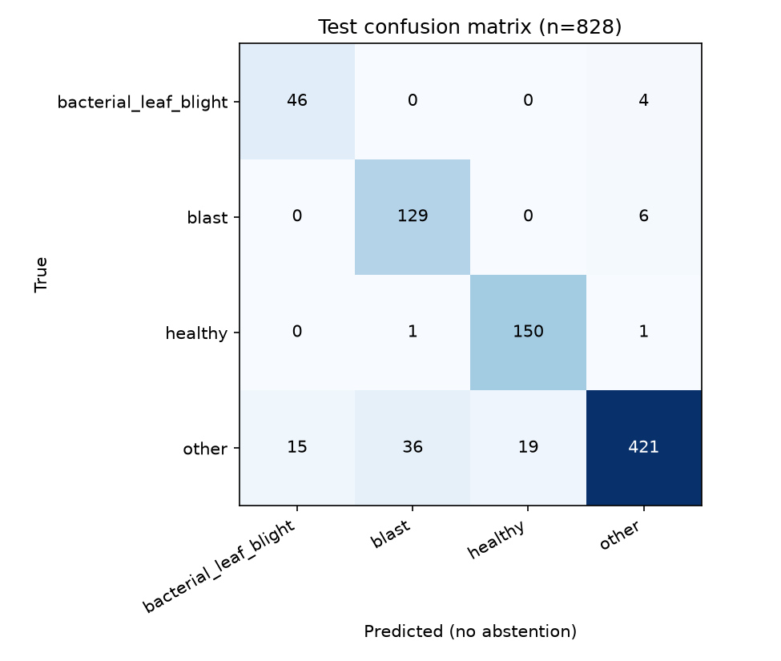
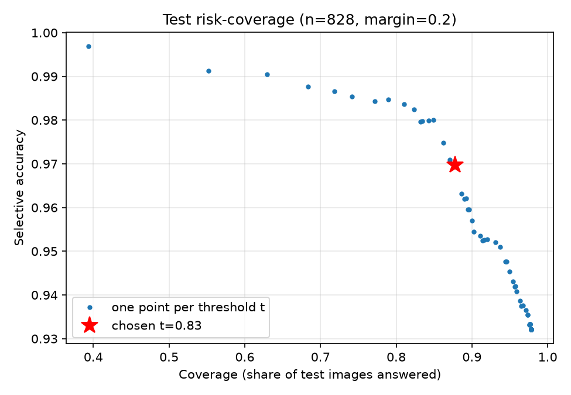

# Kom Bish evaluation report

Model `mobilenetv3_large_100.ra_in1k`, trained 2026-10-11. Every proportion is shown as k/n with a Wilson 95% interval.

## Method

Byte-identical duplicate files were removed, and photos filed under two classes with different targets were dropped. Images were then split once, before any augmentation, into train/validation/test (70/15/15, seed 42, stratified by source and class; near-duplicate images kept in one split). One temperature T = 0.6603 was fitted on validation logits. The abstain threshold t = 0.83 and margin = 0.2 were chosen on validation only (target: precision ≥ 0.9 on answered images at coverage ≥ 0.5), never on test. The app abstains when calibrated top-1 confidence is below t or top-1 minus top-2 is below the margin, and then refers the farmer to 16123 or an officer.

Threshold rule used: field: the strict rule, and on field-background validation photos at most 5% of advice answers (BLB, blast, healthy) are wrong.

Dhan-Shomadhan images are part of training in this run (766 train, 167 validation, 155 test). An earlier run without them recognised 2 of 74 field-background blast photos (`results/runs/run1_no_dhs/metrics.json`), so they were added. The cost: there is no longer any blast test from a source the model has never seen.

## 1. In-distribution test split

n = 828. Macro-F1 with no abstention: **0.9037**.

| Class | Support | Precision | Recall | F1 |
|---|---|---|---|---|
| bacterial_leaf_blight | 50 | 40/48 = 0.833 (95% CI 0.704–0.913) | 40/50 = 0.800 (95% CI 0.670–0.888) | 0.816 |
| blast | 135 | 128/148 = 0.865 (95% CI 0.800–0.911) | 128/135 = 0.948 (95% CI 0.897–0.975) | 0.905 |
| healthy | 152 | 149/160 = 0.931 (95% CI 0.881–0.961) | 149/152 = 0.980 (95% CI 0.944–0.993) | 0.955 |
| other | 491 | 452/472 = 0.958 (95% CI 0.935–0.972) | 452/491 = 0.921 (95% CI 0.893–0.941) | 0.939 |

At t = 0.83, margin = 0.2:

- Coverage (images answered): 727/828 = 0.878 (95% CI 0.854–0.899)
- Selective accuracy (correct among answered): 705/727 = 0.970 (95% CI 0.955–0.980)
- Precision on BLB answers: 35/37 = 0.946 (95% CI 0.823–0.985)
- Precision on blast answers: 118/128 = 0.922 (95% CI 0.862–0.957)

Abstained share by true class: bacterial_leaf_blight 0.260, blast 0.096, healthy 0.066, other 0.132.

Confusion matrix (rows = true class, columns = predicted, no abstention):

| true \ predicted | bacterial_leaf_blight | blast | healthy | other |
|---|---|---|---|---|
| bacterial_leaf_blight | 40 | 0 | 0 | 10 |
| blast | 0 | 128 | 0 | 7 |
| healthy | 0 | 0 | 149 | 3 |
| other | 8 | 20 | 11 | 452 |

## 2. Recall per source

Every BLB image comes from RiceLeafBD and every training blast image from BD5, so this table shows whether one source carries the result.

| Source | Source class | Target | Recall (no abstention) | Abstain rate |
|---|---|---|---|---|
| BD5 | blast | blast | 106/106 = 1.000 (95% CI 0.965–1.000) | 3/106 = 0.028 (95% CI 0.010–0.080) |
| BD5 | narrow_brown_spot | other | 67/78 = 0.859 (95% CI 0.765–0.919) | 9/78 = 0.115 (95% CI 0.062–0.205) |
| BD5 | normal_leaf | healthy | 112/115 = 0.974 (95% CI 0.926–0.991) | 8/115 = 0.070 (95% CI 0.036–0.131) |
| BD5 | sheath_blight | other | 85/85 = 1.000 (95% CI 0.957–1.000) | 2/85 = 0.024 (95% CI 0.006–0.082) |
| BD5 | tungro | other | 74/75 = 0.987 (95% CI 0.928–0.998) | 4/75 = 0.053 (95% CI 0.021–0.129) |
| DhanShomadhan | field_browon_spot | other | 6/8 = 0.750 (95% CI 0.409–0.929) | 3/8 = 0.375 (95% CI 0.137–0.694) |
| DhanShomadhan | field_leaf_scaled | other | 7/11 = 0.636 (95% CI 0.354–0.848) | 6/11 = 0.545 (95% CI 0.280–0.787) |
| DhanShomadhan | field_rice_turgro | other | 12/12 = 1.000 (95% CI 0.757–1.000) | 1/12 = 0.083 (95% CI 0.015–0.354) |
| DhanShomadhan | field_sheath_blight | other | 7/9 = 0.778 (95% CI 0.453–0.937) | 5/9 = 0.556 (95% CI 0.267–0.811) |
| DhanShomadhan | white_brown_spot | other | 12/13 = 0.923 (95% CI 0.667–0.986) | 4/13 = 0.308 (95% CI 0.127–0.576) |
| DhanShomadhan | white_leaf_scaled | other | 17/22 = 0.773 (95% CI 0.566–0.899) | 4/22 = 0.182 (95% CI 0.073–0.385) |
| DhanShomadhan | white_rice_blast | blast | 22/29 = 0.759 (95% CI 0.579–0.878) | 10/29 = 0.345 (95% CI 0.199–0.527) |
| DhanShomadhan | white_rice_tungro | other | 16/18 = 0.889 (95% CI 0.672–0.969) | 2/18 = 0.111 (95% CI 0.031–0.328) |
| DhanShomadhan | white_shath_blight | other | 29/33 = 0.879 (95% CI 0.727–0.952) | 7/33 = 0.212 (95% CI 0.107–0.378) |
| RiceLeafBD | bacterial_leaf_blight | bacterial_leaf_blight | 40/50 = 0.800 (95% CI 0.670–0.888) | 13/50 = 0.260 (95% CI 0.159–0.396) |
| RiceLeafBD | brown_spot | other | 52/52 = 1.000 (95% CI 0.931–1.000) | 5/52 = 0.096 (95% CI 0.042–0.206) |
| RiceLeafBD | healthy | healthy | 37/37 = 1.000 (95% CI 0.906–1.000) | 2/37 = 0.054 (95% CI 0.015–0.177) |
| RiceLeafBD | tungro_virus | other | 68/75 = 0.907 (95% CI 0.820–0.954) | 13/75 = 0.173 (95% CI 0.104–0.274) |

### Recall per background

BD5 leaves lie on a white sheet and RiceLeafBD photos are taken in the field, so the background can give the class away. Farmers will send field photos, so the field rows matter most. "Answered wrong" is the share that got a confident wrong answer instead of a referral.

| Background | True class | Recall (no abstention) | Abstain rate | Answered wrong |
|---|---|---|---|---|
| field | bacterial_leaf_blight | 40/50 = 0.800 (95% CI 0.670–0.888) | 13/50 = 0.260 (95% CI 0.159–0.396) | 2/50 = 0.040 (95% CI 0.011–0.135) |
| field | blast | 7/18 = 0.389 (95% CI 0.203–0.614) | 12/18 = 0.667 (95% CI 0.437–0.837) | 3/18 = 0.167 (95% CI 0.058–0.392) |
| field | healthy | 37/37 = 1.000 (95% CI 0.906–1.000) | 2/37 = 0.054 (95% CI 0.015–0.177) | 0/37 = 0.000 (95% CI 0.000–0.094) |
| field | other | 152/167 = 0.910 (95% CI 0.857–0.945) | 33/167 = 0.198 (95% CI 0.144–0.265) | 4/167 = 0.024 (95% CI 0.009–0.060) |
| white | blast | 128/135 = 0.948 (95% CI 0.897–0.975) | 13/135 = 0.096 (95% CI 0.057–0.158) | 4/135 = 0.030 (95% CI 0.012–0.074) |
| white | healthy | 112/115 = 0.974 (95% CI 0.926–0.991) | 8/115 = 0.070 (95% CI 0.036–0.131) | 0/115 = 0.000 (95% CI -0.000–0.032) |
| white | other | 300/324 = 0.926 (95% CI 0.892–0.950) | 32/324 = 0.099 (95% CI 0.071–0.136) | 12/324 = 0.037 (95% CI 0.021–0.064) |

### What the farmer gets (advice-level outcomes)

A BLB, blast or healthy answer above the threshold is **advice**. An `other` answer or an abstention is a **referral** to 16123 or an officer, which is safe. **Wrong advice** is the harmful outcome: advice that does not match the true class.

**Field-background photos (test split plus the held-out field blast), n = 272.** Advice given: 77/272 = 0.283 (95% CI 0.233–0.339). Wrong advice among advice given: 4/77 = 0.052 (95% CI 0.020–0.126).

| True class | n | Correct advice | Referred | Wrong advice |
|---|---|---|---|---|
| bacterial_leaf_blight | 50 | 35/50 = 0.700 (95% CI 0.562–0.809) | 15/50 = 0.300 (95% CI 0.191–0.438) | 0/50 = 0.000 (95% CI 0.000–0.071) |
| blast | 18 | 3/18 = 0.167 (95% CI 0.058–0.392) | 15/18 = 0.833 (95% CI 0.608–0.942) | 0/18 = 0.000 (95% CI 0.000–0.176) |
| healthy | 37 | 35/37 = 0.946 (95% CI 0.823–0.985) | 2/37 = 0.054 (95% CI 0.015–0.177) | 0/37 = 0.000 (95% CI 0.000–0.094) |
| other | 167 | (a referral is the right outcome) | 163/167 = 0.976 (95% CI 0.940–0.991) | 4/167 = 0.024 (95% CI 0.009–0.060) |

Wrong among each kind of advice: bacterial_leaf_blight answers 2/37 = 0.054 (95% CI 0.015–0.177); blast answers 2/5 = 0.400 (95% CI 0.118–0.769); healthy answers 0/35 = 0.000 (95% CI 0.000–0.099).

**All test photos (plus the held-out field blast), n = 846.** Advice given: 314/846 = 0.371 (95% CI 0.339–0.404). Wrong advice among advice given: 16/314 = 0.051 (95% CI 0.032–0.081).

| True class | n | Correct advice | Referred | Wrong advice |
|---|---|---|---|---|
| bacterial_leaf_blight | 50 | 35/50 = 0.700 (95% CI 0.562–0.809) | 15/50 = 0.300 (95% CI 0.191–0.438) | 0/50 = 0.000 (95% CI 0.000–0.071) |
| blast | 153 | 121/153 = 0.791 (95% CI 0.720–0.848) | 32/153 = 0.209 (95% CI 0.152–0.280) | 0/153 = 0.000 (95% CI 0.000–0.024) |
| healthy | 152 | 142/152 = 0.934 (95% CI 0.883–0.964) | 10/152 = 0.066 (95% CI 0.036–0.117) | 0/152 = 0.000 (95% CI 0.000–0.025) |
| other | 491 | (a referral is the right outcome) | 475/491 = 0.967 (95% CI 0.948–0.980) | 16/491 = 0.033 (95% CI 0.020–0.052) |

Wrong among each kind of advice: bacterial_leaf_blight answers 2/37 = 0.054 (95% CI 0.015–0.177); blast answers 10/131 = 0.076 (95% CI 0.042–0.135); healthy answers 4/146 = 0.027 (95% CI 0.011–0.068).

## 3. Dhan-Shomadhan field blast (held-out slice of a source the model has seen)

n = 18 field-background blast images held out from Dhan-Shomadhan. Other Dhan-Shomadhan images were used for training, so this is **not** a cross-source test; with n this small the interval is wide.

- Blast recall (no abstention): 7/18 = 0.389 (95% CI 0.203–0.614)
- Abstain rate: 12/18 = 0.667 (95% CI 0.437–0.837)
- Answered as blast: 3/18 = 0.167 (95% CI 0.058–0.392)

### Near-duplicate leak check

`training/check_leakage.py` compared every validation, test and held-out image with every training image (64-bit perceptual hash, Hamming distance ≤ 5, any class, any source). 2 of 846 test and held-out images and 6 of 863 validation images have a near-duplicate in training. The shipped model through the app's own ONNX code path:

| | Test n | Macro-F1 (no abstention) | Coverage | Selective accuracy | Field wrong advice |
|---|---|---|---|---|---|
| All test images | 828 | 0.9026 | 0.8804 | 0.9684 | 4/77 |
| Without leaked test images | 826 | 0.9036 | 0.8814 | 0.9684 | 4/77 |

These ONNX-on-CPU numbers differ from the tables above (computed in PyTorch on the GPU) by one or two borderline images; the app runs the ONNX model.

Field photos that got wrong advice:

| Photo | True class | Answered as | Confidence |
|---|---|---|---|
| `RiceLeafBD/Tungro Virus/312624486_675060277291867_7528285692741017397_n.jpg` | RiceLeafBD | Tungro Virus | bacterial_leaf_blight | 0.8487 |
| `hf://datasets/Project-AgML/Dhan-Shomadhan_rice_leaf_disease_classification#15` | DhanShomadhan | Field Browon Spot | bacterial_leaf_blight | 0.8551 |
| `hf://datasets/Project-AgML/Dhan-Shomadhan_rice_leaf_disease_classification#136` | DhanShomadhan | Field Leaf Scaled | blast | 0.8533 |
| `hf://datasets/Project-AgML/Dhan-Shomadhan_rice_leaf_disease_classification#244` | DhanShomadhan | Field Sheath Blight | blast | 0.85 |

## 4. The team's own photos and junk photos

Not measured yet: `training/results/own_photos.json` does not exist (steps 19 and 20).

## 5. Off-script test

**0 off-script answers and 0 invented doses in 20 test consultations** (`tests/test_offscript.py`): every sentence shown came from `data/rules.csv` or `data/clips.csv`.

## Limitations

- Source and background confound: every BLB image comes from RiceLeafBD (field photos) and most blast images from BD5 (leaves on a white sheet). A model can learn the background instead of the disease; the first run did exactly that. Sections 2 and 3 are the honest check.
- BD5's official archive (version 2, SHA-256 verified) holds 3,150 images, while its own description says 2,545. We used what the archive contains (`docs/gates.md`).
- Dhan-Shomadhan is in the training data, which removed the only external test: no number in this report comes from a dataset the model has never seen.
- The test split was looked at during development: several training runs were compared, and the threshold rule was tightened after seeing early results (`docs/gates.md` lists every run). The numbers here are therefore somewhat optimistic. Only a new, untouched set of field photos would give a clean estimate.
- With this few test images per minority class, one or two images move a recall by several points; read the intervals, not the point values.
- Own-photo labels are healthy-looking vs symptomatic, not diagnoses.
- The `other` class does not cover non-rice photos; section 4 is the only junk-photo test.
- No field trial. Nobody checked what a farmer did after an answer.
- Agronomy review: none yet; rules and scripts are not reviewed by an agronomist (TODO-HUMAN: name, role and date once someone reads the six rules and four answer scripts).
